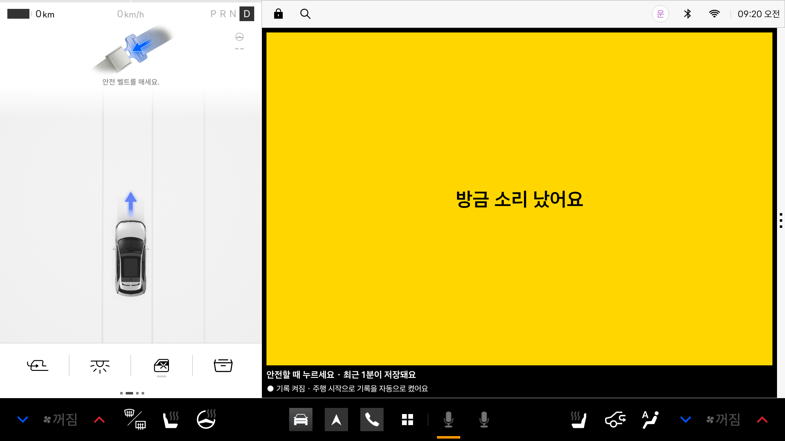
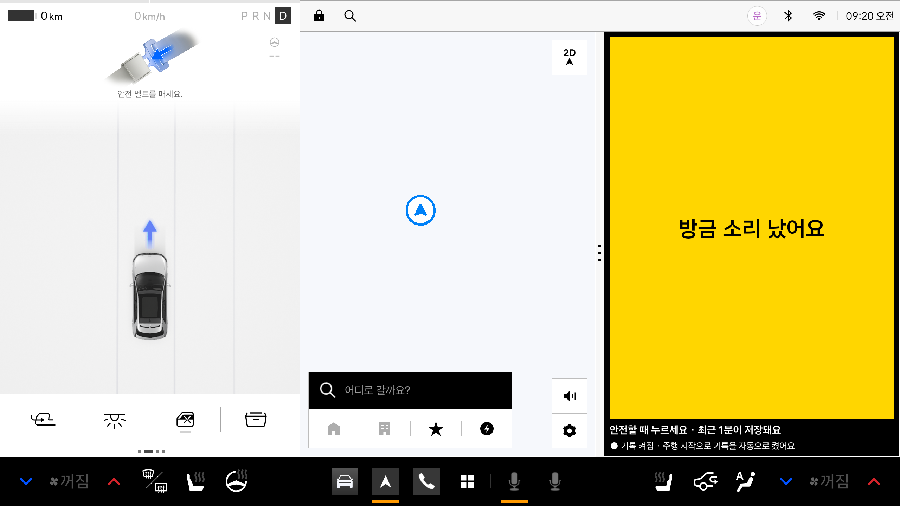
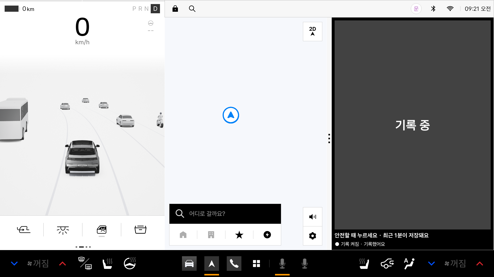
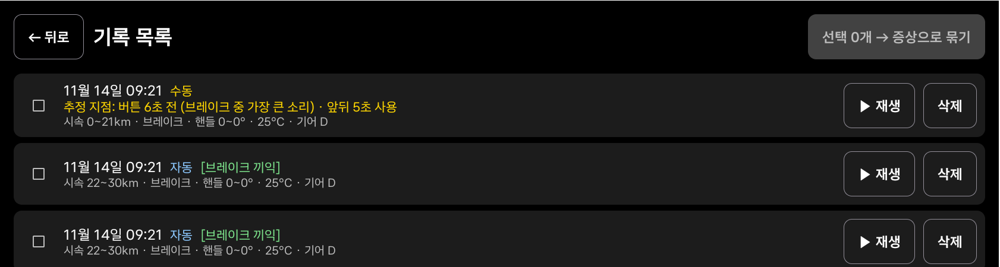
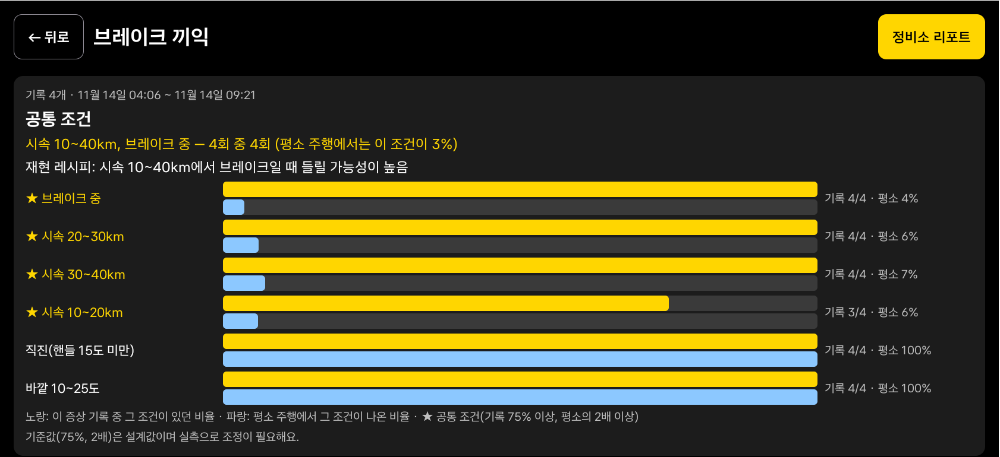
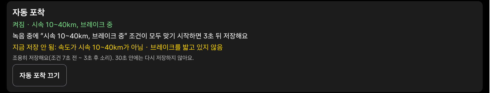
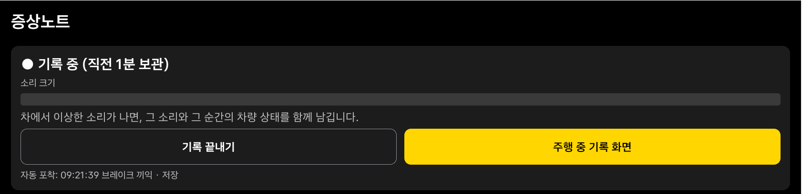
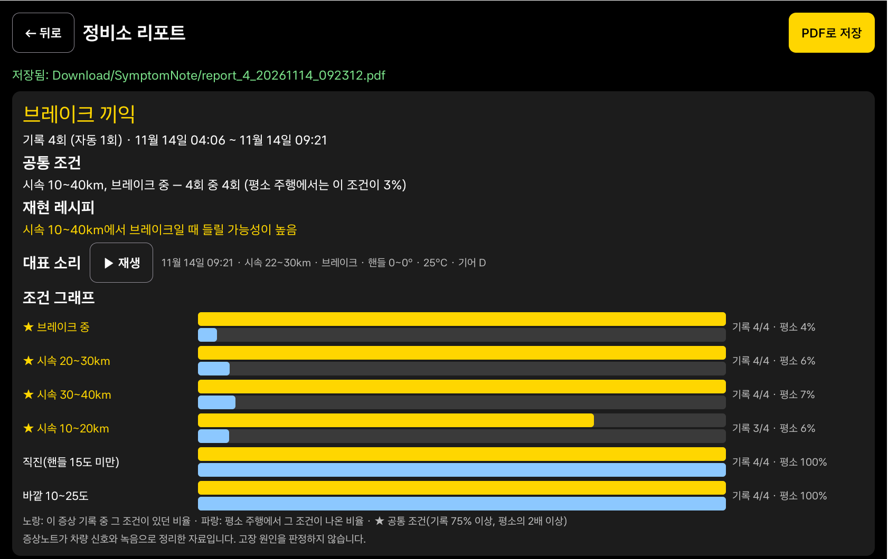
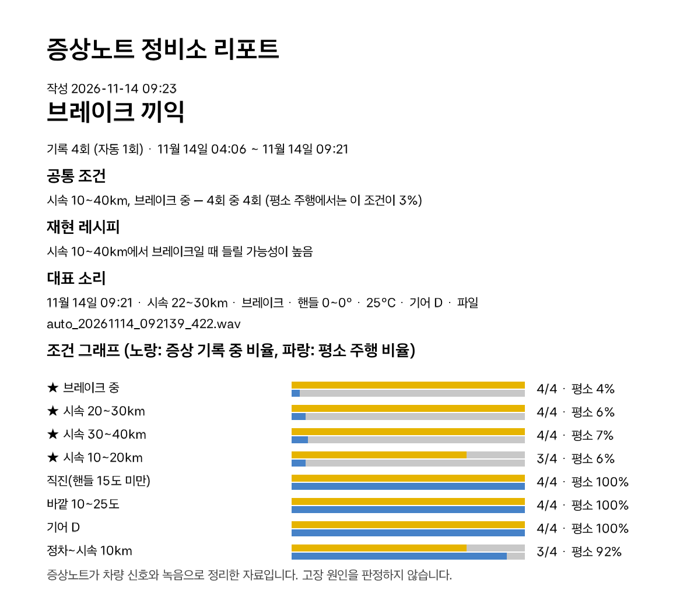
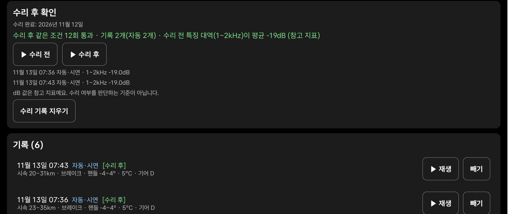

# 증상노트

> 차에서 이상한 소리가 난 순간의 소리와 차량 상태를 함께 남기고, 반복되는 조건을 찾아 정비소에 보여 줄 한 장으로 정리하는 Pleos Connect 차량 앱.

> **심사용 3단계 실행** (Pleos Connect Emulator 2.1.0)
>
> 1. APK 설치: `adb install -r apk/yeokkaengi_증상노트_release.apk` 후 앱 목록에서 증상노트를 연다.
> 2. 처음 열 때 묻는 권한(마이크, 알림, 차량 속도)을 모두 허용한다.
> 3. Virtual Console에서 기어를 D로 바꾼다. 기록이 켜지고 "방금 소리 났어요" 주행 화면이 뜬다.
>    결과 화면부터 보려면 홈 → 설정 → 시연 데이터 불러오기 → 증상·리포트.

## 시작은 이 장면이었다

달릴 때 브레이크를 밟으면 끼익 소리가 난다. 정비소에 차를 가져간다. 정비사가 한 바퀴 돌아보는데 그날따라 소리가 안 난다. "다시 나면 오세요." 그냥 돌아온다.
흔히 겪는 장면이다. 한국소비자원의 자동차 정비 피해 사례 중 33%는 하자 재발이다. 현대차 클레임의 30%는 소음·진동이다.
소리는 말로 설명하기 어렵고, 언제 나는지는 운전자도 정확히 모른다. 그래서 소리가 난 그 순간을 차량 신호와 함께 남기고, 여러 번 모인 기록에서 공통 조건을 찾게 했다.

▶ 시연 영상: (링크 추가 예정)

## 이렇게 써요

> 아래는 모두 Pleos Connect Emulator 2.1.0에서 실제로 실행한 화면이다(목업 없음). 차량 조작은 Virtual Console로 했다.
> 왼쪽은 차량 클러스터, 오른쪽이 앱이다.

### ① 기어를 D로 바꾸면 기록이 켜지고 큰 버튼 화면이 뜬다

기어가 P에서 바뀌면 주차 화면은 시스템이 가린다. 앱은 그 대신 큰 버튼 하나짜리 주행 화면을 띄우고 **기록을 자동으로 켠다**. 화면 아래에 "주행 시작으로 기록을 자동으로 켰어요"가 보인다.
창 막대를 끌면 내비와 반반으로 나눠 쓸 수 있다.

| 기어 D 직후 | 내비와 반반 |
|---|---|
|  |  |

### ② 소리가 나고 1분 안에 누르면, 앱이 소리 난 지점을 찾는다

앱은 직전 60초 소리와 1초 단위 차량 상태를 늘 들고 있다. 그래서 운전자는 소리가 난 순간이 아니라 안전할 때 누르면 된다.
누르면 버튼이 바로 "기록 중"으로 바뀌고, 저장이 끝나면 음성으로 "기록했어요"라고 말한다. 기록 목록에는 "**추정 지점: 버튼 6초 전 (브레이크 중 가장 큰 소리)**"처럼 앱이 찾은 지점이 나온다.

| 누른 순간 | 기록 목록 |
|---|---|
|  |  |

이 캡처에서는 시속 30km로 20초 달린 뒤 브레이크를 밟아 세우고 4초 뒤에 눌렀다.

### ③ 기록을 증상으로 묶으면 공통 조건이 나온다

기록 목록에서 기록을 골라 "브레이크 끼익" 같은 증상으로 묶는다. 앱은 각 조건이 그 증상 기록에 얼마나 있었는지와 평소 주행에 얼마나 있었는지를 비교한다.
실제 주행 기록 4개(수동 3, 자동 1)로 나온 결과는 "**시속 10~40km, 브레이크 중 — 4회 중 4회 (평소 주행에서는 이 조건이 3%)**"였다. 정비사에게 그대로 읽어 줄 수 있는 재현 레시피도 함께 나온다.



### ④ 자동 포착을 켜면 버튼 없이 저장된다

공통 조건으로 자동 포착을 켜면, 녹음 중에 그 조건이 모두 맞기 시작한 뒤 3초에 조용히 저장한다. 증상 화면에는 규칙 문장과 **지금 저장이 안 되는 이유** 한 줄이 보인다. 주차 중이라 "속도가 시속 10~40km가 아님 · 브레이크를 밟고 있지 않음"이 나왔다.
②의 주행에서 시속 30km로 달리다 브레이크를 밟자 09:21:39에 자동 기록이 저장됐다.





### ⑤ 정비소 리포트

증상 하나를 한 장으로 정리한다. 횟수, 기간, 공통 조건, 재현 레시피, 대표 소리, 조건 그래프가 들어간다. **PDF로 저장**하면 `Download/SymptomNote/`에 남는다.
리포트 끝에는 "고장 원인을 판정하지 않습니다"를 적었다. 앱은 정비사가 소리를 다시 내 볼 단서만 준다.

| 앱 화면 | 저장된 PDF |
|---|---|
|  |  |

### ⑥ 수리 후 확인 (시연 데이터)

수리를 받은 날을 기록하면, 그 뒤 같은 조건을 몇 번 지났는지와 그때 자동으로 남은 소리를 수리 전과 비교한다.
시연 데이터에서는 "수리 후 같은 조건 12회 통과 · 기록 2개(자동 2개) · 수리 전 특징 대역(1~2kHz)이 평균 **-19dB** (참고 지표)"가 나왔다. dB 값은 참고 지표다. 수리 여부를 판정하지 않는다.



## APK

`apk/yeokkaengi_증상노트_release.apk` (assembleRelease, 디버그 키 서명, versionName 1.0.0, 패키지 `ai.symptomnote`)

```bash
adb install -r apk/yeokkaengi_증상노트_release.apk
```

## 주요 기능

| 기능 | 내용 |
|---|---|
| 상시 기록 | 마이크 포그라운드 서비스로 직전 60초만 메모리에 들고 있다. 다른 앱이 가려도 계속된다 |
| 주행 시작 자동 기록 | 기어가 P에서 바뀌면 큰 버튼 화면을 띄우고 기록을 켠다(설정에서 끌 수 있음) |
| 주행 중 수동 기록 | 큰 버튼 하나. 직전 60초 소리와 1초 단위 차량 상태를 저장하고 소리 난 지점을 찾는다 |
| 차량 신호 | 속도·기어·바깥 온도(표준), 브레이크·핸들·와이퍼·방향지시등·주행거리(Pleos Vehicle) |
| 증상과 공통 조건 | 기록을 묶으면 조건별로 증상 기록 비율과 평소 주행 비율을 비교한다 |
| 자동 포착 | 공통 조건이 맞기 시작하면 3초 뒤 조용히 저장한다 |
| 정비소 리포트 | 한 장 요약, PDF 저장 |
| 수리 후 확인 | 같은 조건 통과 횟수, 수리 전후 특징 대역 비교 |
| 글레오 | 녹음이 꺼진 상태에서 최근 증상 요약, 기록 시작 방법 안내 |
| 창문 점검 | 운전석 창문을 움직이며 소리를 남기는 실차 전제 기능 |
| 개인정보 | 소리는 기기 안에만 둔다. 기록별 삭제, 녹음 파일 한 번에 삭제 |

## 테스트 환경 및 필요한 설정

| 항목 | 값 |
|---|---|
| 에뮬레이터 | Pleos Connect Emulator 2.1.0 AVD (Android 14 / API 34, 앱 사용자 10), 화면 2560×1440 |
| 마이크 | AVD Extended controls → Microphone → "Virtual microphone uses host audio input" 켜기. 끄면 녹음이 거의 무음이다 |
| Virtual Console | `adb forward tcp:8088 tcp:8088` 후 브라우저에서 `http://127.0.0.1:8088/` |
| 실행 중 요청 권한 | `RECORD_AUDIO`, `POST_NOTIFICATIONS`, `android.car.permission.CAR_SPEED` |
| 선언만 하는 권한 | `FOREGROUND_SERVICE`, `FOREGROUND_SERVICE_MICROPHONE`, `CAR_POWERTRAIN`, `CAR_EXTERIOR_ENVIRONMENT`, `pleos.car.permission.CAR_DRIVE · CAR_WINDOWS · CAR_LIGHTS · CAR_SEATS · CONTROL_CAR_WINDOWS · TTS_SERVICE` |
| 권한 미리 주기(선택) | `adb shell pm grant --user 10 ai.symptomnote android.permission.RECORD_AUDIO` (나머지 두 개도 같은 방식) |
| 네트워크·계정 | 필요 없음 |

### Virtual Console 조작

| 장면 | 화면에서 | curl로 할 때 |
|---|---|---|
| ① 주행 시작 | 기어 D | `curl -X PUT "http://127.0.0.1:8088/vehicle/gear?gear=Drive"` |
| ② 달리다 브레이크 | Accelerator 페달로 시속 30km를 20초 유지 → Brake 페달(60%)로 정차 → 앱의 큰 버튼 | `.../vehicle/controls?speed=30&accelerator=15&brake=0` 을 1초마다, 이어서 `speed`를 줄이며 `brake=60` |
| ③ 증상으로 묶기 | 기어 P → 홈 → 기록 목록 → 기록 고르기 → 증상으로 묶기 | `.../vehicle/gear?gear=Park` |
| ④ 자동 포착 | 증상 화면 → 자동 포착 켜기 → 다시 D → 시속 10~40km에서 Brake | ②와 같음 |
| ⑤ 리포트 | 기어 P → 증상 화면 → 정비소 리포트 → PDF로 저장 | 조작 없음 |
| ⑥ 수리 후 확인 | 기어 P → 설정 → 시연 데이터 불러오기 → 증상·리포트 → "(시연)" 증상 | 조작 없음 |

- 이번 캡처는 curl로 조작했고, 그동안 1초마다 `POST /browser/session?client=<id>`를 함께 보냈다.
- 시연이 끝나면 설정 → 시연 데이터 지우기.
- 장면별 시연 순서와 대사는 [docs/demo-scenario.md](docs/demo-scenario.md).

## 빌드와 단위 테스트

- Gradle 8.10.2 wrapper, AGP 8.8.2, Kotlin 2.0.0, JDK 17, Jetpack Compose
- compileSdk 35 / targetSdk 34 / minSdk 28
- Pleos Vehicle 2.3.2, Pleos TextToSpeech 3.3.1, Room 2.6.1(KSP)
- `local.properties`에 `sdk.dir=<Android SDK 경로>`를 적는다.

```bash
JAVA_HOME=<JDK 17 경로> ./gradlew assembleDebug testDebugUnitTest
```

```bash
JAVA_HOME=<JDK 17 경로> ./gradlew assembleRelease
```

단위 테스트는 35개다. 조건 계산, 자동 포착 시점, 소리 난 지점 추정, 대역 에너지, 시연 데이터 결과를 확인한다. 파일별 내용은 [docs/verification.md](docs/verification.md).

## 구조

```
app/src/main/java/ai/symptomnote/
├── App.kt                      앱 시작 시 차량 신호 구독과 자동 포착 시작
├── Settings.kt                 설정 값(주행 시작 자동 기록)
├── audio/Audio.kt              직전 60초 링 버퍼(RingRecorder), WAV 저장, 재생
├── core/                       안드로이드 의존 없는 계산(단위 테스트 대상)
│   ├── Conditions.kt           조건 후보, 공통 조건, 통과 횟수, 화면 문장
│   ├── PointEstimate.kt        소리 난 지점 추정, 대표 구간 자르기
│   ├── AutoCaptureJudge.kt     자동 포착 판단(시작 순간, 3초, 30초)
│   ├── SoundAnalysis.kt        FFT, 대역 에너지, 수리 전후 비교
│   ├── Grouping.kt             증상 묶기 규칙(시연·실제 섞기 막기)
│   └── RecordingPolicy.kt      주행 시작 자동 기록 조건
├── data/Db.kt                  Room: 1초 주행 기록, 녹음 기록, 증상
├── service/
│   ├── Recorder.kt             마이크 서비스, 수동·자동 저장
│   └── SymptomAnalyzer.kt      증상 화면·리포트용 분석 묶음
├── vehicle/
│   ├── VehicleSignals.kt       표준·Pleos 신호 구독, 1초 요약
│   ├── Platform.kt             주행 제한 감지, TTS와 오디오 포커스
│   └── WindowChecker.kt        창문 점검 흐름
├── gleo/GleoReceiver.kt        글레오 조회 함수 두 개
├── demo/
│   ├── DemoPlan.kt             시연 데이터 설계(순수 계산)
│   └── DemoData.kt             시연 데이터 저장·삭제
└── ui/
    ├── MainActivity.kt         주차 화면(홈과 화면 전환)
    ├── DrivingRecordActivity.kt 주행 중 큰 버튼 화면
    ├── RecordScreens.kt        기록 목록, 증상 묶기, 증상 목록
    ├── SymptomScreens.kt       증상 상세, 리포트, PDF
    ├── OtherScreens.kt         창문 점검, 설정
    └── Common.kt               색, 버튼, 패널 같은 공통 요소
app/src/main/assets/schema.json 글레오 함수 등록
app/src/test/                   단위 테스트 35개
docs/                           근거 기록, 플랫폼 확인 사항, 시연 순서, 발전 계획, 개발 규칙
apk/                            제출용 APK
```

## 에뮬레이터에서 확인한 것과 하지 못한 것

확인한 것

- 기어 D에서 주차 화면은 시스템이 가리고, 큰 버튼 화면은 쓸 수 있다. 내비와 반반으로 나눠도 동작한다.
- 다른 앱이 화면을 가려도 녹음이 이어진다.
- 버튼을 누르고 "기록 중"이 그려질 때까지 29ms, 저장 완료까지 69ms가 걸렸다(이번 캡처 때 로그).
- "기록했어요" 음성 앞에 오디오 포커스를 받고, 음성이 끝나면 돌려준다.
- 자동 포착은 조건이 맞기 시작하고 3초 뒤 저장됐다(09:21:36 조건 시작 → 09:21:39 저장).
- 실측 근거 표는 [docs/verification.md](docs/verification.md).

하지 못한 것, 다르게 동작한 것

- 녹음 중에는 글레오 음성 호출이 동작하지 않는다. 글레오가 다른 앱이 마이크를 쓰는 것을 보고 호출을 포기한다. 그래서 글레오 함수는 녹음이 꺼진 상태에서 쓰는 조회용만 두었다. 자세한 내용은 [docs/platform-findings.md](docs/platform-findings.md).
- 창문 점검은 실차 전제다. 에뮬레이터에는 실제 창문이 없어 창문 소리가 녹음되지 않는다. 창문 제어 뒤 값 변화도 한 번은 없었고, 다른 날에는 목표 값에 도달했다. 원인은 확인하지 못했다.
- 이 에뮬레이터의 동승석 착석 값은 반대로 온다(비어 있으면 `true`). 앱은 `WindowChecker.kt`의 상수 하나로 뒤집어 읽는다. 실차에서는 다시 확인해야 한다.
- 에뮬레이터의 바깥 온도는 25°C로 고정이다. 그래서 "차가운 날" 조건은 시연 데이터에서만 볼 수 있다.
- 이번 캡처 때는 PC 마이크로 소리를 넣지 않았다. 홈의 소리 크기 막대는 비어 있었고, ②의 추정 지점은 거의 무음 속에서 가장 큰 1초다.
- 실차에서는 시험하지 못했다. 공통 조건 기준(75%, 2배)과 자동 포착 시간은 실차 데이터로 다시 맞춰야 한다.

## 개발 방식

브랜치, 커밋 메시지, 버전 규칙은 [docs/CONTRIBUTING.md](docs/CONTRIBUTING.md)에 있다. GitHub Flow, Conventional Commits, 유의적 버전을 쓴다. 커밋 전에 `./gradlew testDebugUnitTest`가 통과하는지 확인한다.
